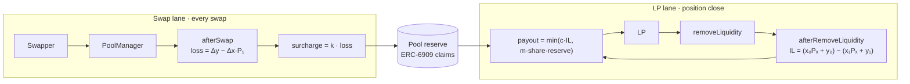

# Mechanism

Ballast runs two independent lanes. Swaps fund the reserve on every trade. LPs draw from it only when a position closes, and only up to what the reserve holds at that moment.



## Collection

Swaps pay a surcharge on the loss they impose, measured per block:

```
surcharge = k · (Δy − Δx · P₁),   0 < k < 1
```

- Δx, Δy are the block's net deltas and P₁ its closing price, so in-block round trips net out and splitting a swap does not reduce the charge. How the hook accumulates and settles this across swaps is open ([AV-12](06-attack-vectors.md#av-12-swap-splitting), [AV-28](06-attack-vectors.md#av-28-per-swap-loss-over-counts-in-block-round-trips)).
- **k** is the ballast rate. The starting range is 0.1–0.3; the backtest fixes the final value.
- The surcharge is returned as a hook delta from `afterSwap` and minted to the hook as ERC-6909 claims, credited to that pool's reserve.
- It is charged in the swap's unspecified currency: the output token on exact-in swaps, the input token on exact-out swaps, converted at P₁.
- It is charged on top of the pool's LP fee and shows up in quotes like any hook fee. LP fees are unaffected.

## Payout

The hook records each position's entry and settles it at exit.

- **Entry** (`afterAddLiquidity`): liquidity, range, entry time and the reference price Pₑ.
- **Exit** (`afterRemoveLiquidity`): the reference price Pₓ.

x₀, y₀ are the token amounts the removed liquidity holds in its range at Pₑ; x₁, y₁ the amounts at Pₓ. They are computed, not read from the pool, so the pool's spot price does not affect IL.

Realized IL, in token1 units:

```
IL = (x₀ · Pₓ + y₀) − (x₁ · Pₓ + y₁)
```

The first term is what the deposit would be worth if it had never been pooled. The second is what the position actually returns. Fees earned are not netted against the claim.

If IL ≤ 0 nothing is paid. Otherwise:

```
payout = min(c · IL, m · share · reserve)
```

### Position accounting

- Positions are keyed by (owner, tickLower, tickUpper, salt), the same key as v4.
- A removal settles only the liquidity removed. The remainder stays on record.
- Adding to an existing position updates Pₑ and the entry time to liquidity-weighted averages.
- Only removals (`liquidityDelta < 0`) settle a claim.

## Payout rules

The reserve is not a guarantee. These rules keep it solvent and limit how much any one claim can take. Attacks against them are in [Attack vectors](06-attack-vectors.md).

| Rule | Setting | Purpose | Related |
| --- | --- | --- | --- |
| Coverage cap **c** | ≤ 50% of IL | Keeps total claims fundable; full coverage cannot be. | |
| Pro-rata draw **m** | One claim takes at most m × its share of the reserve. Share is the position's hold value at Pₓ over the hold value of all open positions, tracked by the hook. A 2% position with m = 3 can draw up to 6%. | Spreads the reserve across claimants. | AV-06, AV-07, AV-25 |
| Minimum hold **H** | Positions open less than H (e.g. 24h) are not paid. | Excludes short-lived positions. | AV-04, AV-05 |
| Price reference | Chainlink, with the hook's own TWAP (≥ 30 min) as fallback and cross-check. If neither is usable, or they disagree beyond a bound, the claim pays zero. | IL is measured against a price the claimant does not control. | AV-04, AV-15, AV-16 |

When the reserve is empty, withdrawals still succeed and pay nothing. Payouts round down and are drawn from both reserve tokens pro rata by value at Pₓ.

Aggregate payouts are bounded by roughly k of total IL, since the reserve takes in about k × LVR. c limits individual claims; when c > k, claims are served in order of arrival until the reserve runs low. Ownership and custody of the reserve are covered in [Security](04-security.md).
