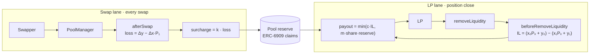

# Mechanism

Ballast runs two independent lanes. Swaps fund the reserve on every trade. LPs draw from it only when a position closes, and only up to what the reserve holds at that moment.



## Collection

Each swap pays:

```
surcharge = k · (Δy − Δx · P₁),   0 < k < 1
```

- **k** is the ballast rate. The starting range is 0.1–0.3; the backtest fixes the final value.
- The surcharge is returned as a hook delta from `afterSwap` and minted to the hook as ERC-6909 claims, credited to that pool's reserve.
- It is intended to be taken in the output token, the token LPs are losing. The exact-output case is tracked in [AV-13](06-attack-vectors.md#av-13-exact-output-swaps).
- It is charged on top of the pool's LP fee and shows up in quotes like any hook fee. LP fees are unaffected.

## Payout

The hook records each position's entry and settles it at exit.

- **Entry** (`afterAddLiquidity`): token amounts deposited, x₀ and y₀, and the reference price Pₑ.
- **Exit** (`beforeRemoveLiquidity`): token amounts coming out, x₁ and y₁, and the reference price Pₓ.

Realized IL, in token1 units:

```
IL = (x₀ · Pₓ + y₀) − (x₁ · Pₓ + y₁)
```

The first term is what the deposit would be worth if it had never been pooled. The second is what the position actually returns. Fees earned are not netted against the claim.

If IL ≤ 0 nothing is paid. Otherwise:

```
payout = min(c · IL, m · liquidityShare · reserve)
```

### Position accounting

- Positions are keyed by (owner, tickLower, tickUpper, salt), the same key as v4.
- A partial removal scales x₀ and y₀ by the fraction withdrawn. The remainder stays on record.
- Adding to an existing position updates the record to a liquidity-weighted average entry.

## Payout rules

The reserve is not a guarantee. These rules keep it solvent and limit how much any one claim can take. Attacks against them are in [Attack vectors](06-attack-vectors.md).

| Rule | Setting | Purpose | Related |
| --- | --- | --- | --- |
| Coverage cap **c** | ≤ 50% of IL | Keeps total claims fundable; full coverage cannot be. | |
| Pro-rata draw **m** | One claim takes at most m × its liquidity share of the reserve. A 2% position with m = 3 can draw up to 6%. | Spreads the reserve across claimants. | AV-06, AV-07, AV-25 |
| Minimum hold **H** | Positions open less than H (e.g. 24h) are not paid. | Excludes short-lived positions. | AV-04, AV-05 |
| Price reference | Chainlink where available, otherwise the pool's TWAP over ≥ 30 min. Pₑ and Pₓ use the same source. | IL is measured against a price the claimant does not control. | AV-04, AV-15, AV-16 |

When the reserve is empty, withdrawals still succeed and pay nothing. Ownership and custody of the reserve are covered in [Security](04-security.md).
