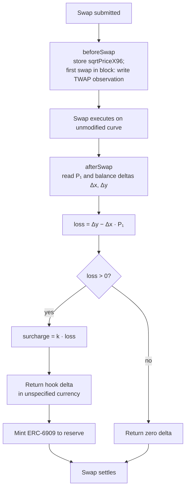
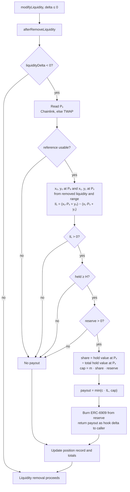
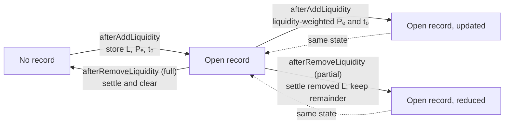

# Hook lifecycle

Five callbacks are enabled. They take seven flag bits because `afterSwap` and `afterRemoveLiquidity` also return deltas. The flags are declared in `src/BallastReserveHook.sol` and asserted in `test/BallastReserveHook.t.sol`. The swap curve is not modified (`vanillaSwap: true`).

Each deployment serves exactly one pool. The PoolKey, k, c, H, m and the oracle settings are constructor immutables.

## Permission flags

| Callback | Flag | Behaviour |
| --- | --- | --- |
| `afterInitialize` | on | Revert with `PoolNotAllowed` unless the PoolKey matches the constructor's. Seed the first TWAP observation. |
| `beforeSwap` | on | Store the pre-swap `sqrtPriceX96`. On the first swap of a block, write a TWAP observation. |
| `afterSwap` + `afterSwapReturnsDelta` | on | Compute the loss from the actual deltas, return k·loss as a hook delta in the unspecified currency and mint it to the reserve. |
| `afterAddLiquidity` | on | Create or update the position record (liquidity, Pₑ, entry time) and the running totals used for the pro-rata share. |
| `afterRemoveLiquidity` + `afterRemoveLiquidityReturnsDelta` | on | Compute IL for the removed liquidity, apply the payout rules, burn ERC-6909 from the reserve and return the payout as a hook delta credited to the caller. Scale or clear the record. |

Off: `beforeInitialize`, `beforeAddLiquidity`, `beforeRemoveLiquidity`, both donate hooks, `beforeSwapReturnsDelta` and `afterAddLiquidityReturnsDelta`.

## Custody

Reserve balances are ERC-6909 claims on the PoolManager. See [Security](04-security.md#custody).

## Swap flow

The charged currency is the output token on exact-in swaps and the input token on exact-out swaps, converted at P₁. This flow is per swap; moving to a per-block measure ([AV-28](06-attack-vectors.md#av-28-per-swap-loss-over-counts-in-block-round-trips)) will change it.

## Payout flow

Every path ends with the removal going through. "Reference usable" means Chainlink is fresh and valid or the TWAP is available, and the two agree within the deviation bound when both exist.

## Position record

Dotted edges mark the same state drawn twice for readability. Key: (owner, tickLower, tickUpper, salt).
