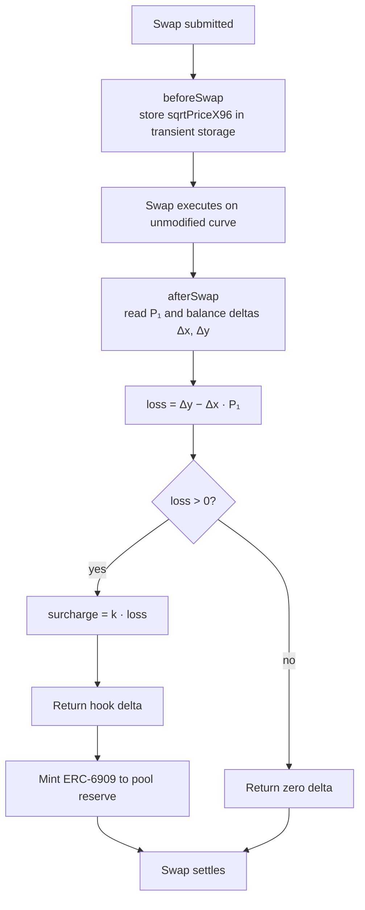
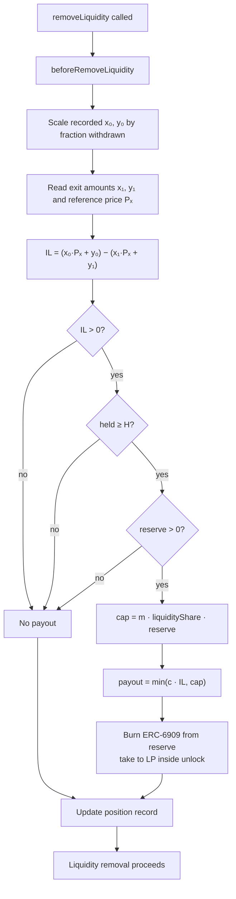
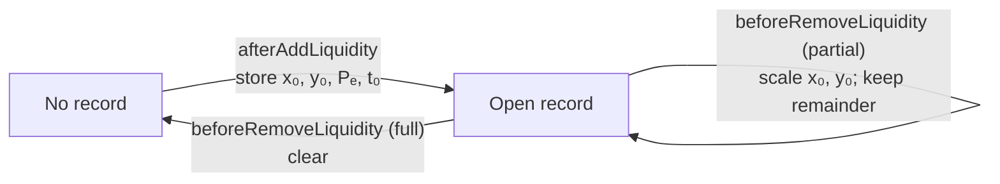

# Hook lifecycle

Five callbacks are enabled. They take six flag bits because `afterSwap` also returns a delta. The flags are declared in `src/BallastReserveHook.sol` and asserted in `test/BallastReserveHook.t.sol`. The swap curve is not modified (`vanillaSwap: true`).

## Permission flags

| Callback | Flag | Behaviour |
| --- | --- | --- |
| `afterInitialize` | on | Store the pool's k, c, H, m and oracle. Reject pools with no oracle and no TWAP fallback. |
| `beforeSwap` | on | Store the pre-swap `sqrtPriceX96` in transient storage. |
| `afterSwap` + `afterSwapReturnsDelta` | on | Compute loss = Δy − Δx·P₁ from the actual deltas, return k·loss as a hook delta and mint it to the pool reserve. |
| `afterAddLiquidity` | on | Create or update the position's entry record (x₀, y₀, Pₑ, entry time). |
| `beforeRemoveLiquidity` | on | Compute IL, apply the payout rules, burn ERC-6909 from the reserve and pay the LP. Scale or clear the record. |

Off: `beforeInitialize`, `beforeAddLiquidity`, `afterRemoveLiquidity`, both donate hooks, `beforeSwapReturnsDelta` and both liquidity return-delta flags.

## Custody

The hook holds no tokens directly. Reserve balances are ERC-6909 claims on the PoolManager, tracked per pool. Payouts are a burn plus `take` inside the PoolManager's unlock callback.

## Swap flow

The loss is computed from the actual deltas, so swap direction and exact-in or exact-out do not change the formula. The currency charged on exact-output swaps is tracked in [AV-13](07-attack-vectors.md#av-13-exact-output-swaps).

## Payout flow

Every path ends with the removal going through.

## Position record

