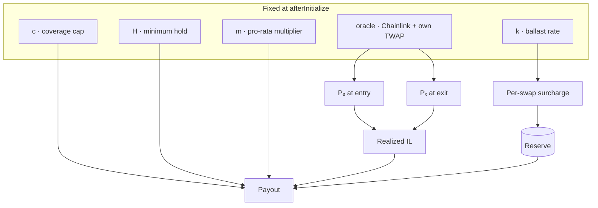

# Parameters

Four numbers decide whether the economics work. All four are fixed by replaying real pool history, not by estimates; the backtest is tracked in the [roadmap](roadmap.md#backtest-plan).

| Parameter | Meaning | Starting range |
| --- | --- | --- |
| k | Ballast rate: share of each swap's loss collected | 0.1 – 0.3 |
| c | Coverage cap: max share of a position's IL reimbursed | 0.3 – 0.5 |
| H | Minimum hold before a claim is valid | 24 – 72 h |
| m | Pro-rata multiplier on a claim's value share | 2 – 5 |

Oracle settings, also from the backtest:

| Setting | Meaning |
| --- | --- |
| TWAP window | ≥ 30 min |
| TWAP cardinality | Observations kept; one per block with a swap |
| Staleness limit | Max age of a Chainlink answer |
| Sequencer grace period | Wait after the L2 sequencer comes back up |
| Deviation bound | Max Chainlink vs TWAP gap before a claim pays zero |
| Minimum pool depth | Below this the TWAP is not trusted |

All of these, the four parameters and the PoolKey are constructor immutables. One hook serves one pool.

They feed the surcharge and payout as follows:

