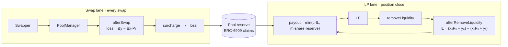

# Ballast: Design Logic

Oct 10, 2026 · @Enrique Berrueta

Ballast is a Uniswap v4 hook for volatile pairs: swappers pay a small surcharge proportional to the loss their trade imposes on LPs, the surcharge accumulates in a pool-owned reserve, and LPs who withdraw at a loss versus holding get a capped, pro-rata share of that loss back.

## The loss being covered

An LP in a volatile pair ends up holding more of the token that fell and less of the token that rose. Versus simply holding the deposit, that is a loss whichever way price moves. It is called impermanent loss (IL) when measured over a position's life, and loss-versus-rebalancing (LVR) when measured swap by swap; over long horizons the two are approximately the same number.

LP profit is fees minus that loss. On most volatile pairs the loss is a large fraction of fees, and in high-volatility periods it exceeds them. Dynamic-fee hooks shrink the gap; nothing on v4 today pays any of it back.

The loss is caused by the external price moving, not by the swap. A swap only transmits it: an arbitrageur sees the pool is stale, trades it back to market, and keeps the difference. If no one arbs, LPs still hold the mispriced portfolio.

## Why not charge it 1:1

The loss a swap imposes on LPs is computable in `afterSwap`. For a swap that sells Δx of token0 and takes Δy of token1, moving the price from P₀ to P₁ (token1 per token0):

```math
\text{loss}_{\text{swap}} = \Delta y - \Delta x \cdot P_1 \;\ge\; 0
```

It is non-negative because the trader got an average price better than P₁. Measured once per block, from the block's opening price to its closing price, it approximates the pool's LVR. Summed swap by swap it does not: every leg of an in-block round trip (a sandwich, a back-run, noise that reverses) adds a positive term although LPs end the block where they started. On ETH/USDC the per-block loss is 12–21% of the per-swap sum (backtest, Ethereum mainnet, Jan 28 – Feb 9 2025).

Charging it back in full fails for two reasons:

1. It is the trader's price impact, already paid. Adding it again roughly doubles price impact. The arbitrageur's profit is exactly this term, so at 1:1 arbitrage is zero-EV and stops. The pool goes stale and LPs still carry the mispriced portfolio, now without the fee.
2. Noise trades do not cause lasting loss. A trade that pushes price up and a later trade that pushes it back produce two positive loss terms that net to zero for LPs. Charging both makes the pool uncompetitive with any unhooked pool, and routers avoid it.

This is why Bunni's am-AMM, Angstrom and LodeHook capture a fraction of LVR through auctions or top-of-block premiums rather than all of it. The equilibrium is to take as much as possible while the arbitrageur still shows up.

## How Ballast works



The two lanes never meet at swap time. Collection happens on every swap; payout happens only when a position closes, and only from what the reserve holds at that moment.

## Collection: the per-swap surcharge

Swaps pay a surcharge proportional to the loss they impose, not a flat rate. The loss is measured per block, so in-block round trips net out and splitting a swap into pieces does not reduce the charge:

```math
\text{surcharge} = k \cdot (\Delta y - \Delta x \cdot P_1), \qquad 0 < k < 1
```

Here Δx, Δy are the block's net deltas and P₁ its closing price; how the hook accumulates them across swaps in a block and settles the charge is an open design item (AV-12, AV-28). k is the ballast rate. Noise trades with tiny price impact pay almost nothing; large price-moving trades, which are disproportionately informed or arbitrage flow, fund most of the reserve. A starting range for k is 0.1 to 0.3, to be fixed by backtest.

The surcharge is taken in `afterSwap` via `afterSwapReturnsDelta`, from the output token. The hook mints the amount to itself as ERC-6909 claims on the PoolManager, credited to that pool's reserve. The reserve therefore accumulates in whichever token swappers are buying, which is the token LPs are being drained of and the right asset to pay claims in.

The surcharge is in addition to the pool's LP fee. It is visible in quotes like any hook fee, so routers price it. A surcharge-free unhooked pool of the same pair will always quote slightly better; the pitch to LPs is lower net loss, and to routers it is that k-scaled surcharges on small trades round to zero.

LP fees themselves are untouched and go to LPs as usual.

Coverage ceiling: an LP position is never worth more than holding its deposit, so every exit has IL ≥ 0, and over long horizons the IL realized across all LPs is approximately the pool's LVR. Reserve inflow is k × LVR. Aggregate payouts therefore cannot exceed roughly k of aggregate IL, whatever c is. c caps a single claim; when c > k the reserve is drawn down and claims are served in order of arrival. Realistic aggregate coverage is 10–20% of IL.

## Payout: measuring a position's realized IL

A position's IL is only known when it closes. On `afterAddLiquidity` the hook records, per position, its liquidity, range, entry time and the reference price at entry Pₑ. On `afterRemoveLiquidity` it reads the reference price at exit Pₓ. The amounts are not read from the pool: x₀, y₀ are the token amounts the removed liquidity holds in its range at Pₑ, and x₁, y₁ the amounts it holds at Pₓ. IL then depends only on liquidity, range, Pₑ and Pₓ, so moving the pool's spot price around the removal cannot inflate it (AV-02). The loss versus holding, in token1 units:

```math
\text{IL} = (x_0 \cdot P_x + y_0) - (x_1 \cdot P_x + y_1)
```

The first term is what the deposit would be worth today if never pooled; the second is what the position actually returns. Fees earned are excluded: they are the LP's compensation and are not netted against the claim (netting them would make the product cover only LPs who also lost on fees, which is nearly nobody).

If IL ≤ 0 the LP is paid nothing. If IL > 0 the claim is:

```math
\text{payout} = \min\big(c \cdot \text{IL},\; m \cdot \text{share} \cdot \text{reserve}\big)
```

c is the coverage ratio, a hard cap on the fraction of IL reimbursed (for example 0.5). The reserve-share term is defined in the next section.

Positions are identified by (owner, tickLower, tickUpper, salt), the same key v4 uses. A removal settles only the liquidity removed; the rest stays on record. Additions to an existing position update the record to a liquidity-weighted average of both Pₑ and entry time, so topping up an aged position does not inherit its age (AV-05). Only calls with `liquidityDelta < 0` settle a claim; zero-delta calls that collect fees are ignored (AV-01).

## Payout rules

The reserve is never a promise. Four rules keep it solvent and hard to game.

| Rule | Setting | Why |
| --- | --- | --- |
| Coverage cap c | ≤ 50% of IL | Full coverage is undercapitalized by construction; Bancor paused its 100% IL protection in June 2022 when claims exceeded the reserve. |
| Pro-rata draw | A single claim may take at most its share of the reserve times a multiplier m, e.g. a position worth 2% of all open positions may draw at most 2% × 3 = 6% (m = 3, so small claims are not starved). The share is by value, not liquidity units: the position's hold value at Pₓ over the hold value at Pₓ of every position the hook has on record, which it tracks as running totals of x₀ and y₀ (AV-06). | Prevents one large exit from draining the reserve ahead of everyone else. |
| Minimum hold | Positions open less than H (e.g. 24h) get no payout | Stops deposit → nudge price → withdraw → claim within a block or a few. |
| Price reference | Chainlink feed, with the hook's own TWAP (≥ 30 min) as fallback and cross-check. See Oracle under Design decisions. | A spot or short TWAP can be moved by the claimant. Entry and exit use the same reference, so the only way to inflate IL is to move a long-window price. |

When the reserve is empty, withdrawals still succeed and pay nothing. Payouts round down. Ownership, custody and the trust model: `04-security.md`.

## Hook lifecycle

Five callbacks are enabled, using seven permission bits (two callbacks also return deltas); everything else is off. The swap curve is untouched (`vanillaSwap: true`), which keeps the hook eligible for Uniswap interface routing and simple to audit.

| Callback | Flag | What Ballast does |
| --- | --- | --- |
| `afterInitialize` | on | Reverts unless the PoolKey matches the one fixed in the constructor. Seeds the first TWAP observation. |
| `beforeSwap` | on | Records `sqrtPriceX96` before the swap. On the first swap of a block, writes a TWAP observation. |
| `afterSwap` + `afterSwapReturnsDelta` | on | Reads the post-swap price, computes the loss, returns a delta of k·loss in the unspecified currency (output token on exact-in, input token on exact-out, AV-13), mints it as ERC-6909 to the reserve. |
| `afterAddLiquidity` | on | Records or updates the position's liquidity, entry reference price and entry time; updates the running totals. |
| `afterRemoveLiquidity` + `afterRemoveLiquidityReturnsDelta` | on | Computes IL for the removed liquidity, applies the rules, burns ERC-6909 from the reserve and returns the payout as a hook delta credited to the caller. Scales or clears the position record. |

`beforeInitialize`, `beforeAddLiquidity`, `beforeRemoveLiquidity`, donate hooks, `beforeSwapReturnsDelta` and `afterAddLiquidityReturnsDelta` stay off. The hook holds no funds outside the PoolManager; all reserve balances are ERC-6909 claims.

## Security

Trust model and custody: `04-security.md`. Attacks, defenses and open findings: `06-attack-vectors.md`.

## Design decisions

Resolutions of attack vectors, decided Oct 10, 2026. Each still needs its test in `06-attack-vectors.md`.

**One hook per pool (AV-18, AV-19, AV-23).** The constructor fixes currency0, currency1, fee, tickSpacing, k, c, H, m, the Chainlink feed, the L2 sequencer-uptime feed and the TWAP settings as immutables. `afterInitialize` reverts for any other key; the PoolManager already rejects a second initialization of the same key. With one pool per deployment, the hook's ERC-6909 balance is that pool's reserve, so no pool can draw on another's; nobody but the deployer chooses parameters or tokens.

**Payout through the caller's delta (AV-03).** The callback `sender` is the router or PositionManager, not the LP, so paying `sender` would strand or misdirect the payout. The hook settles in `afterRemoveLiquidity` and returns the payout as a hook delta: it burns its ERC-6909 claims and the amount is credited to the caller's balance delta, which flows wherever the removed liquidity goes. Through PositionManager that is the NFT owner. A transferred position NFT carries its record and claim to the new owner; this is accepted.

**Oracle: Chainlink with the hook's own TWAP (AV-15, AV-16, AV-17).** v4 core keeps no observations, so the hook writes one per block in `beforeSwap` into a ring buffer and computes a TWAP over at least 30 minutes. Pₑ and Pₓ come from Chainlink when the feed is fresh, positive and the sequencer has been up past its grace period; otherwise from the TWAP. When both are available and differ by more than a deviation bound, the claim pays zero. All oracle reads are wrapped so that any failure pays zero and the removal proceeds. Cardinality, window, staleness limit, deviation bound and minimum pool depth come from the backtest.

**Amounts at the reference price (AV-02).** See Payout above: x₀, y₀, x₁, y₁ are computed from liquidity and range at Pₑ and Pₓ, never read from the pool.

**Value-based share (AV-06).** See Payout rules: share is hold value at Pₓ over the tracked total.

**Hold time and zero-delta calls (AV-01, AV-05).** See Payout above.

**Rounding (AV-08).** Payouts and surcharges round in favour of the reserve. Record scaling on partial removals rounds against the claimant.

**Payout mix (AV-10).** The payout is drawn from both reserve tokens pro rata by their value at Pₓ. The claimant does not choose the mix.

**Exact-output swaps (AV-13).** `afterSwapReturnsDelta` can only charge the unspecified currency. On exact-output swaps that is the input token, and the surcharge is converted to it at P₁.

**Per-block loss (AV-12, AV-28). Open.** Candidate: store the block's opening price and the net deltas so far; on each swap, recompute the block's net loss and charge k times the increase over the highest value already charged in that block, never less than zero. Splitting a swap leaves the total unchanged, and a reversing leg pays nothing, but the charge follows the block's peak excursion rather than its net move. To be evaluated in the backtest before it is adopted.

## Parameters

Four numbers decide whether the economics close. None should be guessed; all come from replaying real pool history.

| Parameter | Meaning | Starting range |
| --- | --- | --- |
| k | Ballast rate: share of per-swap loss collected | 0.1 – 0.3 |
| c | Coverage cap: max share of a position's IL reimbursed | 0.3 – 0.5 |
| H | Minimum hold before a claim is valid | 24 – 72 h |
| m | Pro-rata multiplier on a claim's liquidity share | 2 – 5 |

The backtest that fixes these values and the delivery plan are in `roadmap.md`.

### Tiers (decided 2026-10-10)

The pool creator picks k from three tiers at deployment: Light 0.3, Standard 0.5, Heavy 0.7. c = 0.5, H = 24h and m = 3 are constants. k is immutable and validated in the constructor, so AV-19 is closed by construction. On mainnet ETH/USDC the tiers cost 1.7 / 2.8 / 4.0 bps of volume and fund roughly 15% / 22% / 28% of realized IL (`05-parameters.md`, `07-backtest-results.md`).

Name note: a `BallastHook` already exists in the registry (an unrelated launchpad fee hook on Robinhood Chain). The contract is named `BallastReserveHook` to avoid the collision; the project name stays Ballast.
