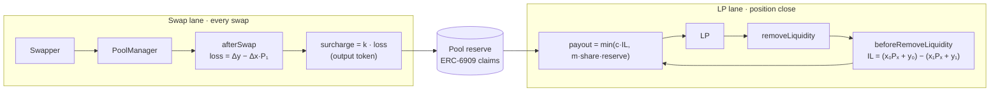
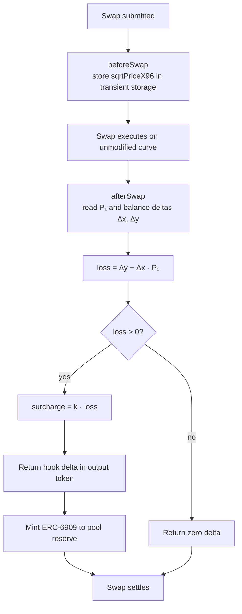
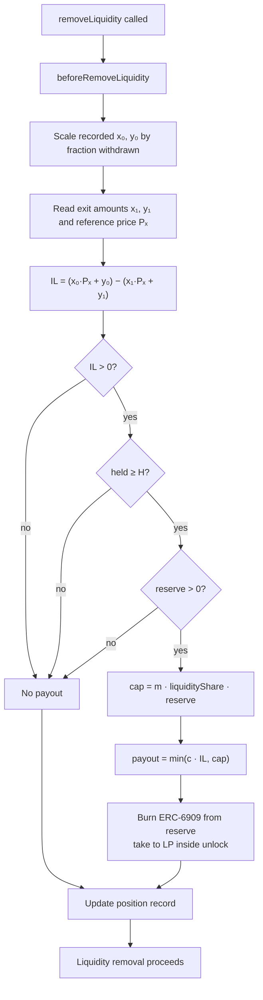
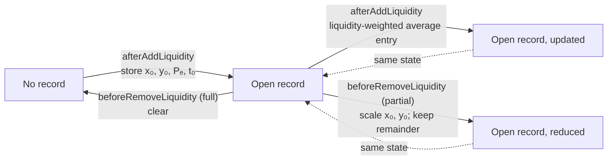
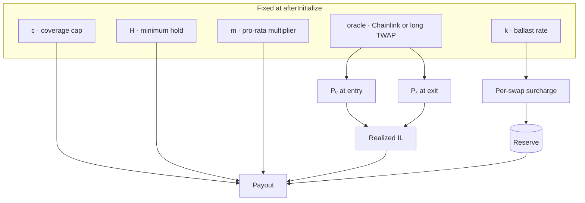
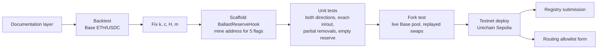

# Diagrams

All diagrams are Mermaid flowcharts, which are directed acyclic graphs. GitHub, VS Code and most Markdown viewers render them inline. To export SVGs, run `npx -y @mermaid-js/mermaid-cli -i docs/diagrams.md -o docs/assets/diagrams.svg` (downloads a headless browser on first run).

## 1. System overview: two lanes, one reserve

## 2. Swap lane

Direction and exact-in/exact-out mode do not matter: the loss term is computed from the actual deltas in both cases.

## 3. Payout decision

Every path ends in the removal proceeding. The hook never blocks withdrawal.

## 4. Position record lifecycle

Dotted edges mark that the node is the same state drawn twice for readability. Key: (owner, tickLower, tickUpper, salt).

## 5. Parameter dependencies

## 6. Delivery dependencies

