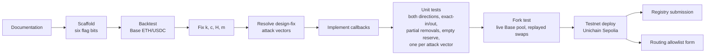

# Roadmap

Temporary planning page. It holds everything about what comes next and how we get there. Delete it once the hook ships.

## Status

The Foundry project builds and the hook compiles with its final permission flags. Every callback is still a pass-through.

## Steps

Steps are in order; each one gates the next.

- [x] **Documentation.** `design-logic.md` is the canonical source.
- [x] **Scaffold.** `BallastReserveHook` from v4-template, with the six flag bits, pass-through callbacks and an address-mining deploy script.
- [ ] **Backtest** on Base ETH/USDC to fix k, c, H and m. See [Backtest plan](#backtest-plan).
- [ ] **Resolve design findings.** Settle every `design-fix` vector in [Attack vectors](06-attack-vectors.md) in `design-logic.md`, then update the affected pages. Currently AV-02, AV-03, AV-05, AV-06, AV-12, AV-13, AV-15 and AV-19.
- [ ] **Implement** the callbacks. Each TODO in `src/BallastReserveHook.sol` maps to a row in [Hook lifecycle](03-hook-lifecycle.md).
- [ ] **Unit tests.** Both swap directions, exact-in and exact-out, partial removals, empty reserve, and one test per open attack vector.
- [ ] **Fork test** against the live Base pool with replayed swaps.
- [ ] **Testnet** deploy on Unichain Sepolia, then registry submission and the Uniswap routing allowlist form.

## Backtest plan

Replay several months of swaps and liquidity events from the Base ETH/USDC v4 pool. The code is in `backtest/` ([README](../backtest/README.md)). Parameter meanings and starting ranges are in [Parameters](05-parameters.md).

For each candidate k:

1. Accumulate the reserve swap by swap using loss = Δy − Δx·P₁.
2. For each closed position, compute realized IL at the entry and exit reference prices.
3. Apply the payout rules under each candidate c, H and m.

Report:

- Reserve-to-claims ratio over time.
- Share of losing LPs paid up to c.
- Surcharge in bps of volume, on median trades and in aggregate.
- Whether splitting a position across salts beats the pro-rata cap ([AV-07](06-attack-vectors.md#av-07-splitting-across-salts)).
- Reserve accrual when arbitrageurs split swaps ([AV-12](06-attack-vectors.md#av-12-swap-splitting)).
- Payout distribution under adversarial claim ordering ([AV-25](06-attack-vectors.md#av-25-front-running-exits)).

### Success criterion

The economics work if some k keeps the surcharge under about 2 bps of volume on median trades and still funds payouts at c ≥ 0.3 ([AV-26](06-attack-vectors.md#av-26-unroutable-pool)).
